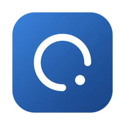
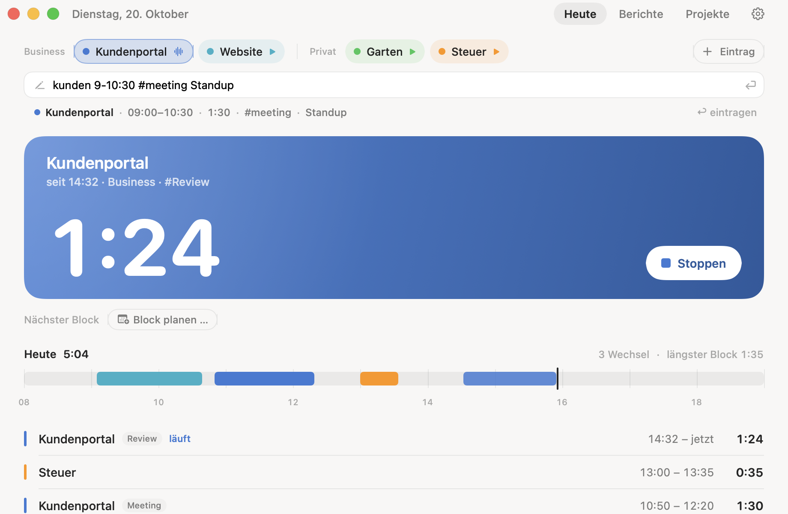
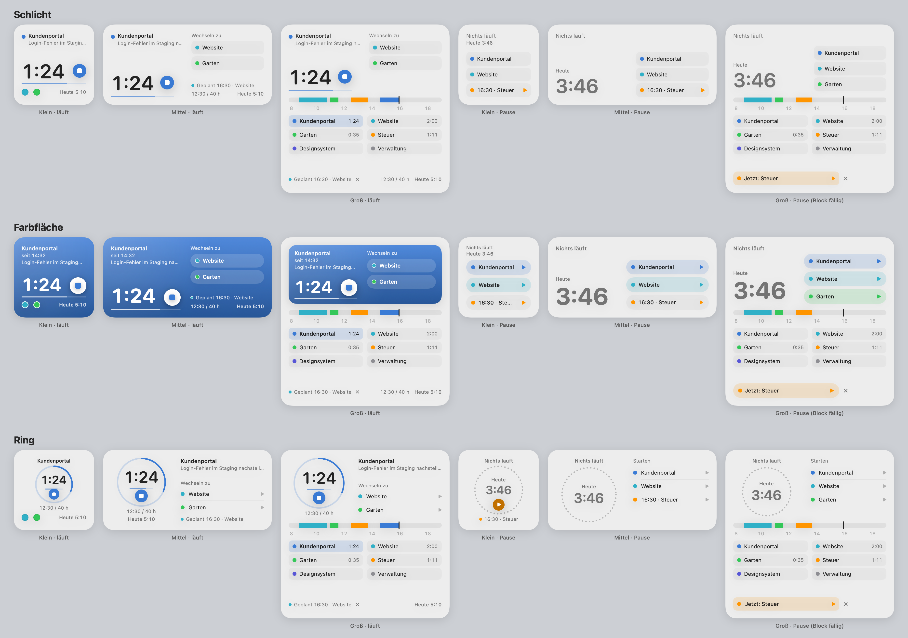

<p align="center">
  
</p>

<h1 align="center">Takt</h1>

<p align="center">Minimalistischer Zeittracker für macOS mit Schreibtisch‑Widget, Menüleiste und Abrechnung – gebaut für freiberufliche Softwareentwickler.</p>

---

## Warum Takt

Toggl & Co. leben im Browser. Takt lebt dort, wo du arbeitest: als **Widget auf dem Schreibtisch**, als **Kapsel in der Menüleiste** und per **Kurzbefehl aus jeder App**. Alles bleibt lokal in einer SQLite-Datei auf deinem Mac. Keine Cloud, kein Konto, keine Abo-Gebühr.

Grundsätze: ein Blick, eine Aussage · beobachten statt erziehen · Projektfarbe als einziger Akzent · Hell und Dunkel.

## Funktionen

**Erfassen**
- Start/Stopp in App, Widget, Menüleiste oder mit **⌃⌥⌘T** von überall; immer nur ein Timer, Wechsel stoppt automatisch
- **Schnelleingabe** (`⌘N` in der App, `⌃⌥⌘N` als schwebendes Fenster): `Kundenportal 9-10:30 #meeting Standup`, `Website 1h30`, `Steuer gestern 20-21`
- **Befehlspalette ⌘K**: Projekte starten, Zeiträume wechseln, exportieren, Einstellungen, alles per Tastatur
- Notiz „Nächster Schritt“ beim Stoppen, Tags pro Eintrag, Einträge bearbeiten/anlegen/löschen
- Leerlauf-Erkennung („23 Min inaktiv: abziehen / behalten / stoppen“), Nachfrage bei vergessenem Timer
- Geplanter nächster Block mit Erinnerung

**Widget** (klein, mittel, groß; Stile *Schlicht*, *Farbfläche*, *Ring*, pro Widget wählbar, optional auf ein Projekt fixiert)
- Laufendes Projekt, Dauer ohne Sekunden, Stopp, Wechsel zu den letzten Projekten, nächster Schritt
- Pausen-/Pomodoro-Fortschritt, Budget im Ring, geplanter Block, Tagesleiste im großen Widget

**Menüleiste**: Stile *Symbol*, *Kompakt*, *Text*, *Kapsel*, *Ring*; Popover mit Stopp, Projektwechsel, Schnelleingabe; Dock-Symbol ausblendbar

**Fokus**: Pausenerinnerung, optionaler Pomodoro-Modus, Kennzahlen zu Projektwechseln und tiefen Blöcken, Ruhezeiten für Mitteilungen

**Musik**: Beim Start spielt die Playlist des Projekts, beim Stopp pausiert sie – Spotify, Apple Music (Mediathek) oder Browser/YouTube

**Abrechnung & Berichte**
- Projekte mit Business/Privat, Kunde, Stundensatz, abrechenbar, Stundenbudget
- Berichte für Tag · Woche · Monat · Jahr · Zeitraum: Summen, Umsatz, **effektiver Stundensatz**, Tags, Kunden, Vorjahresvergleich
- Rundung (6/15/30 Min), Wochenziel, freie Tage (Urlaub/Krank/Feiertag)
- **CSV-Export** (Excel-tauglich), **Timesheet-PDF** für Kunden, **Toggl-Import**

**Anbindungen**
- **Kalender (EventKit)**: Termine in der Tagesleiste, Termin → Eintrag per Regel, Spiegelung der Zeiten in einen Kalender „Takt“ (iCloud/Google)
- **Aktivität**: erkennt App, Fenstertitel und Git-Repo, schlägt Projekte vor („Timer läuft auf X, du arbeitest in Y“)
- App Intents für Kurzbefehle und Siri

## Screenshots

<p align="center">
  <br>
  
</p>

> Bilder folgen; bis dahin zeigt `docs/SPEC.md` die Gestaltung in Worten.

## Voraussetzungen

- macOS 15 oder neuer (Widgets mit interaktiven Knöpfen ab macOS 14; die App zielt auf 15)
- Xcode 16+ mit Swift 5.x-Toolchain
- [XcodeGen](https://github.com/yonaskolb/XcodeGen) (`brew install xcodegen`)
- Ein Apple-Account in Xcode (kostenloses Personal Team genügt) – nötig, weil Widget und App über eine App Group dieselbe Datenbank nutzen

## Bauen und installieren

```bash
git clone https://github.com/eremia2001/takt.git
cd takt
```

1. In `project.yml` die Werte `DEVELOPMENT_TEAM` (deine Team-ID) und die App Group in der Form `<TEAMID>.group.dev.eremiya.takt` an beiden Stellen anpassen. Dieselbe Kennung steht in `TaktCore/Sources/TaktCore/AppDatabase.swift` (`appGroupID`).
2. Projekt erzeugen und bauen:

```bash
xcodegen generate
xcodebuild -project Takt.xcodeproj -scheme Takt -configuration Debug \
  -derivedDataPath .build/dd -allowProvisioningUpdates build
```

3. Installieren und starten:

```bash
rm -rf /Applications/Takt.app && cp -R .build/dd/Build/Products/Debug/Takt.app /Applications/
open /Applications/Takt.app
```

Danach das Widget hinzufügen: **Rechtsklick auf den Schreibtisch → „Widgets bearbeiten“ → „Takt“**.

Hinweis: Die App Group muss die **Team-Präfix-Form** haben. Die kurze Form `group.…` bekommt beim kostenlosen Personal Team kein Provisioning-Profil, und das Widget kann die Datenbank dann nicht lesen.

## Tests

Die gesamte Logik (Datenbank, Timer, Berichte, Parser, Export/Import) liegt im Swift-Package `TaktCore` und ist ohne Xcode-Signatur testbar:

```bash
cd TaktCore && swift test
```

## Aufbau

```
Takt/            macOS-App (SwiftUI): Heute, Berichte, Projekte, Einstellungen,
                 Menüleiste, Befehlspalette, Schnelleingabe, Musik, Fokus,
                 Kalender, Aktivität, Export, Hilfe
TaktWidget/      WidgetKit-Extension mit App Intents (interaktive Knöpfe)
TaktCore/        Swift-Package: Modelle, SQLite (GRDB), Repository, Berichte,
                 Schnelleingabe-Parser, CSV/Toggl, Tests
docs/            SPEC.md (Gesamtspezifikation) und spec-*.md je Funktionsbereich
project.yml      XcodeGen-Projektdefinition
```

Datenablage: `~/Library/Group Containers/<TEAMID>.group.dev.eremiya.takt/takt.sqlite` (Migrationen über GRDB, Sicherungen `takt.sqlite.bak-v*` daneben).

## Freigaben, die macOS abfragt

| Freigabe | Wofür | Pflicht? |
|---|---|---|
| Mitteilungen | Pausenerinnerung, Pomodoro, Leerlauf, Budget, vergessener Timer | nein |
| Automation (Spotify / Musik) | Playlist starten und pausieren | nur mit Musik |
| Kalender | Termine anzeigen, Zeiten spiegeln | nur mit Kalender |
| Bedienungshilfen | Fenstertitel lesen (Aktivität), Medientaste im Browser | nur mit Aktivität/Browser-Musik |

Alle Freigaben lassen sich in der App unter **Hilfe → Freigaben** an einem Ort prüfen.

## Kurzbefehle

| Kürzel | Aktion |
|---|---|
| ⌘K | Befehlspalette |
| ⌘N | Schnelleingabe in „Heute“ |
| ⌃⌥⌘N | Schnelleingabe-Fenster aus jeder App |
| ⌃⌥⌘T | Letztes Projekt starten / stoppen |
| ⌘. | Timer stoppen |
| ⌘1 · ⌘2 · ⌘3 | Heute · Berichte · Projekte |
| ⌘, | Einstellungen |
| ⌘? | Hilfe |

## Lizenz

Noch nicht festgelegt. Bis dahin: privates Projekt, Nutzung auf eigene Verantwortung.

---

Entwickelt mit Claude Code; die Spezifikation in `docs/` beschreibt alle Entscheidungen und Abweichungen.
